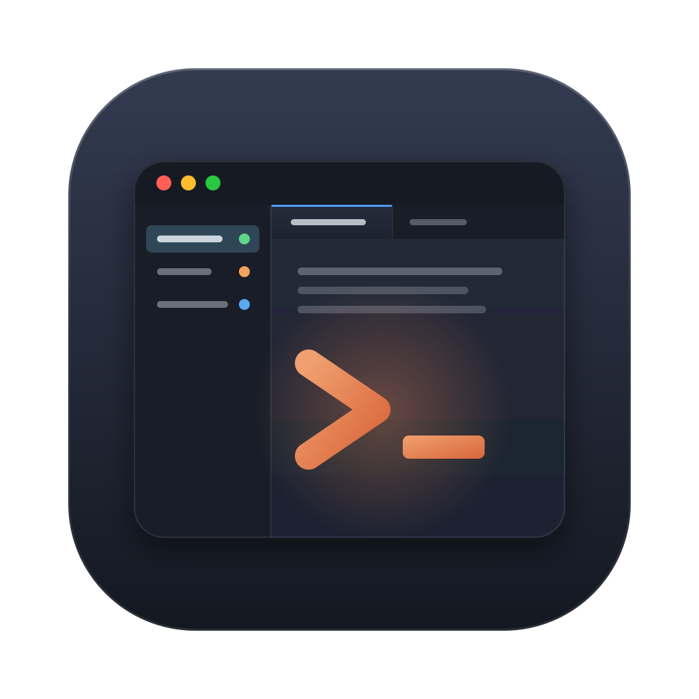
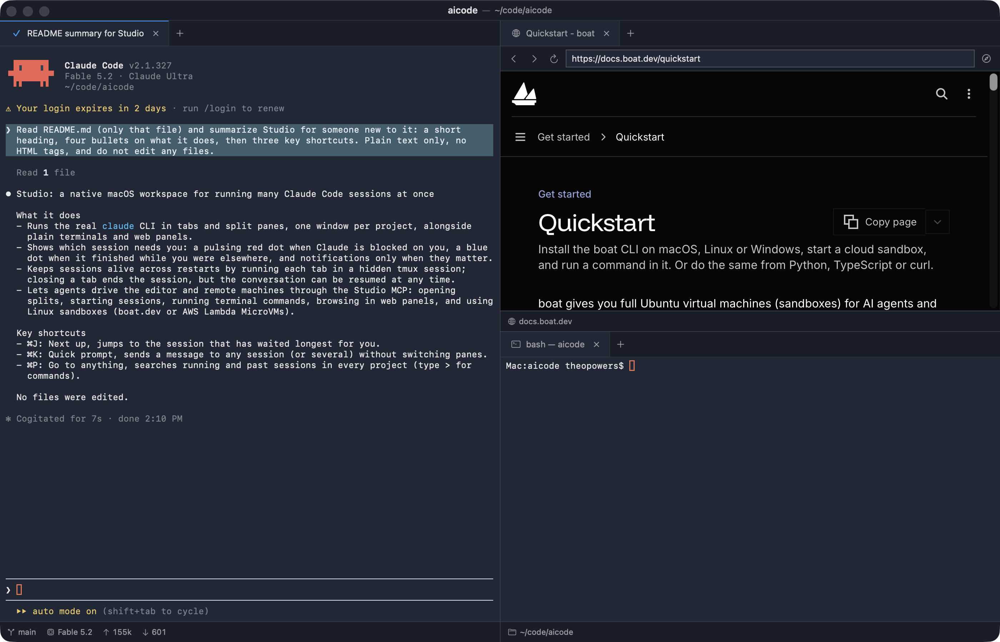

<div align="center">



# Studio

**A native macOS workspace for running many Claude Code sessions at once.**

Tabs, split panes and a command palette, like VS Code, except every pane is a live Claude Code session or terminal.
Studio tells you which session needs you next, so you can keep six agents busy without losing your place.

[](#install)
[](Package.swift)
[](LICENSE)
[](https://github.com/migueldeicaza/SwiftTerm)

[Website](https://fiberevm.github.io/studio/) · [Features](#features) · [Install](#install) · [Shortcuts](#keyboard-shortcuts) · [Sandboxes](#sandboxes) · [Studio MCP](#studio-mcp) · [How it works](#how-it-works) · [Contributing](#contributing)



</div>

---

## Why Studio?

Running several Claude Code sessions in parallel is powerful but noisy: terminal windows pile up, you forget which
agent is waiting on a permission prompt, and every check-in means scanning tabs and scrolling back to see what
happened. Studio is built around one idea: **you should only look at a session when it needs you.**

- **One window per project.** Open `~/code/api` and `~/code/web` side by side; each window holds that repo's sessions and worktrees.
- **Know who's waiting.** Tabs show a working indicator, a pulsing red dot when Claude is blocked on you, and an unread dot when it finished while you were elsewhere.
- **Jump, don't scan.** <kbd>⌘J</kbd> takes you to the session that has waited longest; press it again for the next one. It's inbox zero for agents.
- **Talk without switching.** <kbd>⌘K</kbd> sends a message to any session, or to several at once, without leaving the pane you're in.

## Features

### Sessions
- **Embedded Claude Code** in real terminals ([SwiftTerm](https://github.com/migueldeicaza/SwiftTerm)): it's the real `claude` CLI, so slash commands, hooks, MCP servers and settings all work unchanged.
- **Codex and Antigravity too.** Set **Settings → Sessions → Default agent** to *Codex* or *Antigravity* and new sessions (<kbd>⌘N</kbd>, <kbd>⌘K</kbd>, the `new_session` tool) open OpenAI's [Codex CLI](https://github.com/openai/codex) or Google's Antigravity CLI (`agy`) instead, or pick one per tab from <kbd>⌘P</kbd> → *New Claude / Codex / Antigravity Session*. They get the same treatment as Claude Code: titles, status dots and the sidebar, *needs you* on approval prompts, notifications, ⌘J, ⌘K and snippets, ⌘P history, and restarts that reattach in tmux or resume the exact conversation (`codex resume <id>`, `agy --conversation <id>`). Studio reads their own records: Codex's rollouts in `~/.codex/sessions`, agy's conversation databases in `~/.gemini/antigravity-cli`. Codex also gets the Studio MCP, fork, and model and tokens in the status bar. agy has no per-session MCP option or fork. The native view (<kbd>⌘/</kbd>) is Claude Code only.
- **Imports what's already running.** Studio reads Claude Code's own session files, so sessions started in other terminals show up too.
- **Closing a tab never loses a conversation.** It ends the session; <kbd>⌘P</kbd> resumes it any time, right where it left off.
- **Sessions survive restarts.** Every tab runs in a hidden tmux session that Studio only attaches to. Quit or update Studio and Claude keeps working: in-progress turns, shell commands, dev servers and local chains carry on, and the next launch reattaches every tab, with the same layout and the same processes. Without tmux, or with *Settings → Sessions → Keep sessions running* off, Studio resumes conversations with `claude --resume` instead.
- **Plain terminals** with <kbd>⌃`</kbd>, next to your sessions, just like VS Code.
- **Drag and drop** files or images onto a session to paste their paths.

### Productivity features

Everything here is about one thing: spending your attention only where a session needs it.

| | Feature | What it does for you |
|---|---|---|
| ⏭ | **Next up** <kbd>⌘J</kbd> | Jumps to the session that has waited longest for you. Sessions blocked on a permission prompt or question come first, across every project window. Press it again for the next one; you'll see *All caught up* when the queue is empty. |
| 👀 | **Hover peek** | Rest on a tab for half a second to see the session's status, how long it's been in that state, Claude's last message and your last prompt, without switching to it. |
| 🔴 | **Needs-you badge** | A pulsing red dot means Claude is blocked on you (permission, question). A blue dot means it finished while you were looking elsewhere. A walking pane-grid means it's working. Idle sessions stay quiet. |
| 💬 | **Quick prompt** <kbd>⌘K</kbd> | Type a message and send it to any session without leaving the pane you're in. ↑↓ picks the session; the current one is first. |
| 📣 | **Broadcast** | In <kbd>⌘K</kbd>, press <kbd>⇥</kbd> to tick several sessions and send them all the same message (*"rebase on main"*, *"run the tests"*). |
| 🖋 | **Native view** <kbd>⌘/</kbd> | Swap any session from Claude Code's terminal UI to Studio's own rendering (`claude -p` streaming JSON), laid out and colored like the TUI it replaces, in the theme's terminal palette: left aligned and monospaced, your messages on a band after a `>`, Claude's answers after a ● with real markdown (headings, lists, tables, code in the code color), and tool calls as `● Read(file)` rows (green when they worked, red when they failed) folded into a work log that collapses to *Worked for 14s · 6 steps* once the answer is in. Images (pasted into prompts, or returned by tools like screenshots) show as thumbnails; click one to see it full size. Approvals sit inline with **Decline / Approve**. The input is a `>` line with the permission mode (Supervised, Auto-accept edits, Plan, Full access) and Send on the right; Send turns into Stop while Claude works. Same conversation, one process, same permission mode as the terminal; remembered per session. |
| 🍴 | **Fork** <kbd>⌘E</kbd> | Copy the current conversation into a new session in a split beside it, then take it a different direction. The original keeps going untouched. Also in the tab right-click menu (right or below). |
| ✨ | **Start from a prompt** | <kbd>⌘↵</kbd> in <kbd>⌘K</kbd> starts a new session with your message already sent. |
| 🧩 | **Snippets** | Reusable prompts: type `#` in <kbd>⌘K</kbd> (`#tests`, `#review`, `#pr`, `#rebase`, `#summary`, `#continue`), pick one in <kbd>⌘P</kbd> to send it to the current session, or press <kbd>⌘S</kbd> to save what you typed. Stored as plain JSON you can edit. |
| 🔔 | **Notifications that matter** | Only while you're in another app, only when a session is blocked on you or finished 30+ seconds of work, never for the one you're watching. Each shows Claude's last words; clicking it opens the session. |
| 🔍 | **Go to anything** <kbd>⌘P</kbd> | Fuzzy-search every running and past session in every project, plus all commands. Picking a session in another project opens that project's window. |
| 🧷 | **Nothing is ever lost** | Closing a tab ends the session, but the conversation is one <kbd>⌘P</kbd> away and resumes where it left off. Right-click → *Close Tab, Keep Session Running* to leave it working in the background. Emptied panes stay put with a quiet *New Session* action. |
| 💾 | **Restarts don't interrupt anything** | Each tab lives in a hidden tmux session, so quitting Studio leaves Claude, its commands and your dev servers running; relaunching reattaches every tab, with the same layout and the same processes. |
| 🌿 | **Context at a glance** | Each session's status bar shows its git branch, model and tokens in/out, and Studio finds the PR it opened, with CI and review state. |
| 🌐 | **Web panels** | Open a page in a tab or split, right next to your sessions: a dev server, a sandbox URL, a PR, docs. Back, forward, reload, an editable address bar, and Open in browser; web tabs come back after a restart. Agents open them with `open_url` and drive them like a person: read the page and its numbered elements, click, type and submit, wait, go back, screenshot, or run JavaScript (`web_*` tools). A sandbox's **Open Desktop** shows its desktop in a panel. From ⌘P → *Web: Open URL…*. |
| 🖼 | **Drop to paste** | Drag files or screenshots onto a session to paste their paths into the prompt. |
| ⛵ | **Sandboxes** ([more ↓](#sandboxes)) | Every session can run work in a remote Linux sandbox through `sandbox_*` MCP tools: create one (the project is pushed in), run commands and servers, get an HTTPS URL for a port, open a shell in a split. Claude uses sandboxes when they help (configurable), and deletes one only when you ask. The sandboxes a session uses show as chips in its status bar, with live state and Open Terminal / Desktop / Stop / Resume / Delete. |
| 🤖 | **Agents drive the editor** | Through the Studio MCP, Claude can open splits, start helper sessions, run commands in a terminal next to it, and rearrange your layout. |

### Workspace
- **Split panes** with drag-to-snap: drop a tab on any edge of a pane to split it, or right-click for Split Right / Left / Up / Down.
- **Command palette** (<kbd>⌘P</kbd> / <kbd>⇧⌘P</kbd>): fuzzy-search running and past sessions in every project, plus every command.
- **Themes** with live preview: Clear Dark, Dark Modern, Dark+, Light+, Monokai, Solarized Dark, One Dark Pro, GitHub Dark, Dracula.
- **Status bar per session:** git branch, model, and tokens in/out.
- **PR detection:** finds the PR each session opened (or its branch's PR) through the `gh` CLI, with state, CI checks and review status.

### Built for agents, too
- **Studio MCP:** every session Studio starts can drive the editor itself: open splits, start sessions, run commands in terminals, rearrange the layout, change themes. [See the tools ↓](#studio-mcp)

## Sandboxes

Studio gives every Claude session a remote machine of its own whenever the work calls for one.

### Why sandboxes

- **Agents can host themselves.** A session can start the app it's building in a sandbox, open it on an HTTPS URL (`sandbox_url`) and hand you a link to try it, without touching your laptop's ports or CPU.
- **Agents can orchestrate.** One session can bring up several sandboxes: run the test suite on one, a migration dry run on another, a load test on a third. It keeps going while they work and collects the results.
- **Parallel work doesn't collide.** Six agents on six machines means no fights over port 3000, no shared `node_modules`, and no branch checkouts clobbering each other.
- **Risky work stays contained.** Installing unknown dependencies, running generated scripts and `rm -rf`-adjacent cleanups happen on a disposable VM instead of the machine holding your keys.
- **Long jobs outlive your laptop.** Builds, indexing and soak tests keep running when your lid closes; the sandbox auto-stops (and snapshots) when idle, so it doesn't keep billing.

### How it works

- Every session Studio starts gets the `sandbox_*` MCP tools and a short `studio:sandbox` skill teaching when and how to use them.
- `sandbox_create` brings up a machine and pushes your project into it, git-tracked files only. Claude then runs commands there with `sandbox_exec`, re-pushes after local edits, and can open a shell for you in a split (`sandbox_terminal`).
- **Used when helpful, by default.** Claude brings up a sandbox on its own when it helps (builds, tests, servers, risky or long-running work) and stops it when done. Set **Settings → Sandboxes → Policy** to *Only when I ask* to make that your call. Deleting always needs you.
- **You can always see them.** Every sandbox a session uses appears as a chip in its status bar (`⛵ name ●`, green when running). The chip's menu has Open Terminal, Open Desktop, Copy ID, Stop / Resume, and Delete.
- **Defaults in Settings:** the default provider, machine size, auto-stop time and environment for new sandboxes, plus an off switch per provider. Claude can also pick one per sandbox (`sandbox_create` with `provider: "boat"` or `"aws"`).

### Supported providers

| Provider | | Status | What you need |
|---|---|---|---|
| <a href="https://boat.dev"><picture><source media="(prefers-color-scheme: dark)" srcset="docs/providers/boat-dark.svg"></picture></a> | [boat.dev](https://boat.dev) | ✅ Supported | The `boat` CLI, signed in (`boat login`). Linux VMs from 2 to 16 vCPU, snapshots, fork and resume, HTTPS URLs, desktop. |

| <a href="https://docs.aws.amazon.com/lambda/latest/dg/microvms.html"></a> | [AWS Lambda MicroVMs](https://docs.aws.amazon.com/lambda/latest/dg/microvms.html) | ✅ Supported | The AWS CLI with credentials, and a one-time **Settings → Sandboxes → AWS → Set Up**: it creates an S3 bucket, two IAM roles and a `studio-sandbox` image (Amazon Linux 2023 dev box + Studio's agent) in your account. Firecracker VMs up to 8 h, suspend/resume that keeps memory and processes, an interactive shell (`websocat`). Ports are reached through the MicroVM's endpoint with an auth header, so they open in `curl`, not a browser. |

More are on the way. Providers plug in through the `SandboxProvider` protocol in [`Sources/Studio/Sandbox.swift`](Sources/Studio/Sandbox.swift) (Boat) and [`SandboxAWS.swift`](Sources/Studio/SandboxAWS.swift) (AWS, with its in-VM agent in [`Resources/MicroVMAgent`](Resources/MicroVMAgent)), so the MCP tools, skill, status bar and Settings work unchanged for any provider that can create a machine, run a command, copy files in and expose a port. PRs welcome.

## Install

**Download:** grab `Studio.zip` from the [latest release](https://github.com/fiberevm/studio/releases/latest), unzip it and move Studio to Applications. Release builds are signed with a Developer ID and notarized by Apple.

**Build from source** — requirements: **macOS 14+**, **Xcode 16+ / Swift 6 toolchain**, and [Claude Code](https://docs.claude.com/en/docs/claude-code) (or [Codex](https://github.com/openai/codex), or Antigravity's `agy`) installed and logged in. Recommended: [tmux](https://github.com/tmux/tmux) (`brew install tmux`) so sessions survive Studio restarts. Optional: the [`gh` CLI](https://cli.github.com) for PR detection, and the [`boat` CLI](https://boat.dev) for sandboxes.

```bash
git clone https://github.com/fiberevm/studio.git
cd studio
./build-app.sh --open      # builds build/Studio.app (release) and launches it
```

Copy `build/Studio.app` to `/Applications` if you like. It's signed ad hoc for local use.

Launch options:

```bash
open build/Studio.app --args --new ~/code/my-project      # open a project with a new session
open build/Studio.app --args --resume <session-id>        # resume a specific session
```

## Keyboard shortcuts

| Keys | Action |
|---|---|
| <kbd>⌘P</kbd> | Go to session: search running and past sessions in every project (type `>` for commands) |
| <kbd>⇧⌘P</kbd> | Command palette, including Color Theme |
| <kbd>⌘J</kbd> | Next up: the session that has waited longest for you |
| <kbd>⌘K</kbd> | Quick prompt: message any session (or several) without switching |
| <kbd>⌘E</kbd> | Fork the current session into a new pane to the right |
| <kbd>⌘/</kbd> | Toggle native view (Studio renders the session) / terminal view |
| <kbd>⌘T</kbd> or <kbd>⌘N</kbd> | New tab with a session (Claude Code, Codex or Antigravity, per Settings) in this project |
| <kbd>⌃`</kbd> | New terminal tab |
| <kbd>⇧⌘N</kbd> | Open another project window |
| <kbd>⌘[</kbd> / <kbd>⌘]</kbd> | Previous / next tab |
| <kbd>⌘1</kbd>…<kbd>⌘9</kbd> | Jump to tab (picking a session anywhere puts the cursor in its input) |
| <kbd>⌘W</kbd> | Close tab and end its session (resume it any time from <kbd>⌘P</kbd>); in an empty pane, close the pane |
| <kbd>⇧⌘W</kbd> | Close window |
| <kbd>⌘,</kbd> | Settings: appearance (themes, text size, sidebar), sessions, sandbox providers, snippets |
| <kbd>⌘B</kbd> | Toggle the session sidebar |
| <kbd>⌘+</kbd> / <kbd>⌘−</kbd> / <kbd>⌘0</kbd> | Text size |

## Studio MCP

Every Claude session Studio starts or resumes is launched with an MCP server, `studio-mcp`, that talks to the app.
That lets the agent in any pane drive the editor. For example: *"split a terminal to the right and run the test
watcher"*, or *"lay these out as a 2×2 grid"*.

| Area | Tools |
|---|---|
| Inspect | `get_state`, `list_themes` |
| Sessions, terminals & web | `new_session` (prompt, split, folder, agent: claude / codex / agy), `open_url`, `web_read` / `web_click` / `web_type` / `web_wait` / `web_nav` / `web_screenshot` / `web_eval` (drive a web panel), `fork_session`, `set_view` (native / terminal), `new_terminal` (command, split), `run_in_terminal`, `send_to_session` |
| Tabs | `split_tab`, `move_tab`, `focus_tab`, `close_tab`, `reorder_tab` |
| Layout | `set_layout` (single / columns / rows / grid), `resize_pane`, `set_split_sizes`, `equalize_layout`, `merge_pane`, `focus_pane`, `set_sidebar` |
| Sandboxes | `sandbox_list`, `sandbox_create`, `sandbox_exec`, `sandbox_push`, `sandbox_url`, `sandbox_terminal`, `sandbox_attach` / `sandbox_detach`, `sandbox_stop` / `sandbox_resume` / `sandbox_delete` |
| Appearance & navigation | `set_theme`, `set_font_size`, `open_palette`, `open_project` |

**Always current:** sessions outlive Studio restarts, so when Studio is updated each session's `studio-mcp` swaps in the new build in place and tells Claude its tool list changed. New tools show up in sessions that are already running.

**Skills:** every session Studio starts also loads Studio's own plugin (`--plugin-dir`), with two short skills: `studio:studio` (driving the editor) and `studio:sandbox` (when and how to use sandboxes). They're in `Resources/StudioPlugin/`.

**Security:** the control server listens on `127.0.0.1` only and requires a random token stored in a `0600` file
(`~/Library/Application Support/Studio/control-<bundle-id>.json`). `run_in_terminal` only works on plain terminal tabs.
Each session gets `STUDIO_TAB`, so the agent knows which tab is its own.

## How it works

```
┌──────────────────────────── Studio.app (SwiftUI + AppKit) ────────────────────────────┐
│  ProjectModel (one per window)  ── tabs, split tree, focus, saved layout               │
│  SessionStore (shared)          ── sessions, live status, transcripts, PRs, attention  │
│  TerminalSession                ── SwiftTerm view running `claude` / your shell         │
│  StudioControl                  ── localhost JSON control server  ◄──┐                 │
└──────────────────────────────────────────────────────────────────────┼─────────────────┘
        reads ▲                                                         │ JSON lines + token
              │                                                         │
  ~/.claude/sessions/<pid>.json   (live status: busy / idle / waiting)  │
  ~/.claude/projects/**/<id>.jsonl (titles, prompts, replies, tokens)   │
                                                                        │
  claude --resume … --mcp-config studio.json  ──►  studio-mcp (stdio MCP server) ──┘
```

- **No API keys, no proxy.** Studio runs the `claude` binary you already use, in a real PTY, through your login shell.
- **Read-only on Claude's data.** Session status and transcripts are read from `~/.claude`; Studio never writes there.
- **State** (open tabs, layouts, theme) lives in the app's `UserDefaults`; snippets live in `~/Library/Application Support/Studio/snippets.json`.

### Project layout

```
Sources/Studio/          the app
  StudioApp.swift          scenes, menus and shortcuts
  ProjectModel.swift       per-window tabs, splits, focus, layout persistence
  SessionStore.swift       shared session state, live status, notifications, next up
  Views.swift              window, tab strip, panes, peek card, status bar
  CommandPalette.swift     ⌘P / ⇧⌘P
  QuickPrompt.swift        ⌘K and snippets
  StudioControl.swift      control server behind the MCP tools
  TranscriptScanner.swift  reads titles, prompts and replies from transcripts
  Codex.swift              the same for Codex: reads ~/.codex rollouts (status, titles, tokens), spots approval prompts
  Agy.swift                the same for Antigravity: reads agy's conversation databases (status, approvals) and prompt history
Sources/StudioMCP/       the stdio MCP server bundled next to the app
Resources/               app icon (SVG source + generated .icns)
scripts/make-icon.sh     regenerates AppIcon.icns from AppIcon.svg
website/                 the one-page download site (static HTML; hero is a recording of the real app, assets/demo.mp4)
```

## Roadmap

- [ ] Changes pane: a live git diff of what the session is editing
- [ ] Worktree-per-session with one click
- [ ] Search across every transcript
- [ ] Usage and cost overview per session and project

## Releasing

Push a version tag and GitHub Actions ([`.github/workflows/release.yml`](.github/workflows/release.yml)) builds Studio.app, signs it with your Developer ID (hardened runtime), notarizes and staples it, and publishes `Studio.zip` to a GitHub release:

```bash
git tag v0.2.0 && git push origin v0.2.0
```

It needs five repository secrets: `MACOS_CERT_P12` (base64 of a *Developer ID Application* .p12), `MACOS_CERT_PASSWORD`, and an App Store Connect API key for notarization: `NOTARY_KEY_P8` (base64 of the .p8), `NOTARY_KEY_ID`, `NOTARY_ISSUER_ID`. Without them it publishes an ad hoc–signed build. Locally: `SIGN_IDENTITY="Developer ID Application: …" VERSION=0.2.0 APP=build/release/Studio.app ./build-app.sh`, then `scripts/notarize.sh build/release/Studio.app build/release/Studio.zip`.

## Contributing

Issues and pull requests are welcome. To hack on Studio:

```bash
swift build                 # debug build
./build-app.sh              # release .app bundle in build/
STUDIO_DEBUG_LOG=/tmp/studio.log open build/Studio.app   # trace PR lookups and palette actions
```

Keep the UI flat and quiet (straight lines, no shadows on chrome, VS Code-like density), and keep Claude Code itself
unmodified: Studio should work with whatever version of `claude` is on your PATH.

## License

[MIT](LICENSE)

<sub>Studio is an independent project and is not affiliated with or endorsed by Anthropic. Claude and Claude Code are trademarks of Anthropic.</sub>
